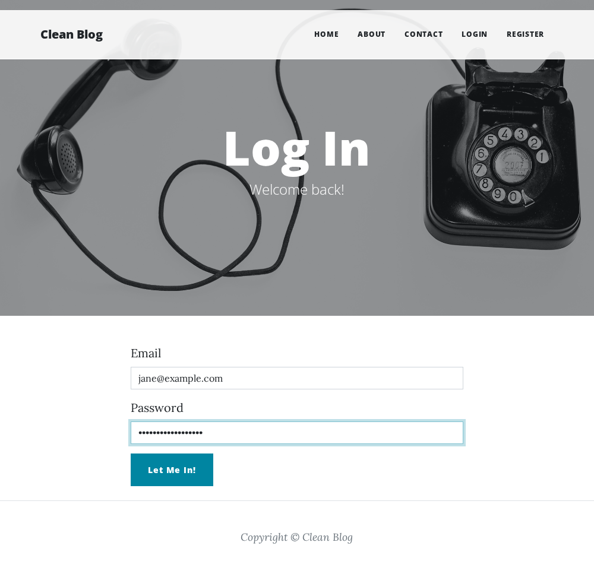
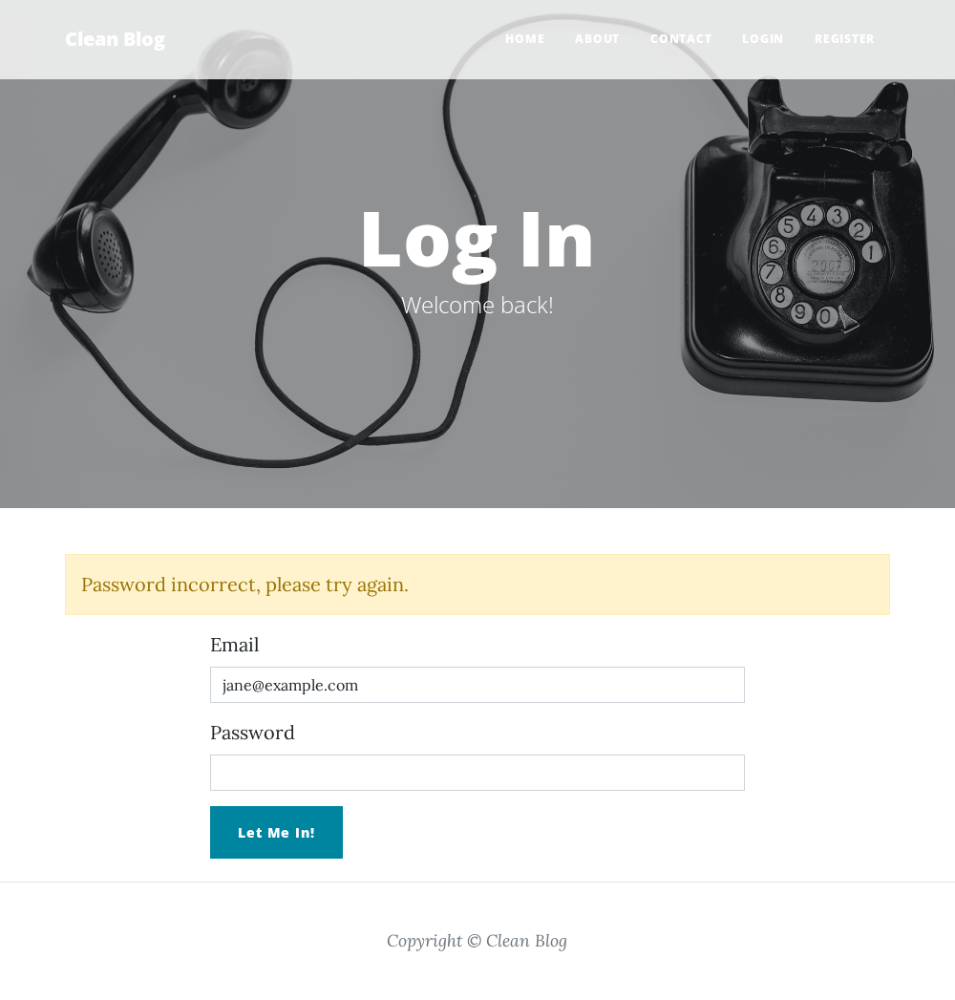
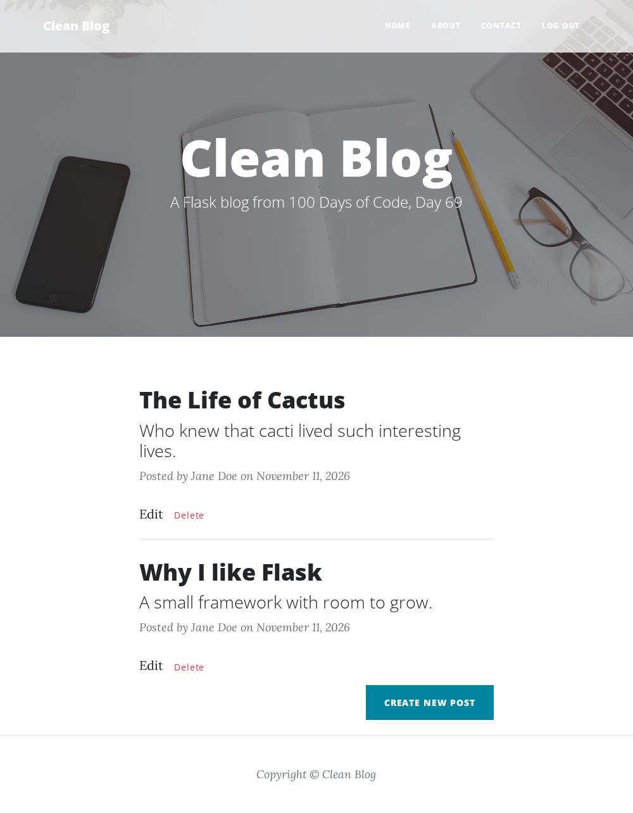
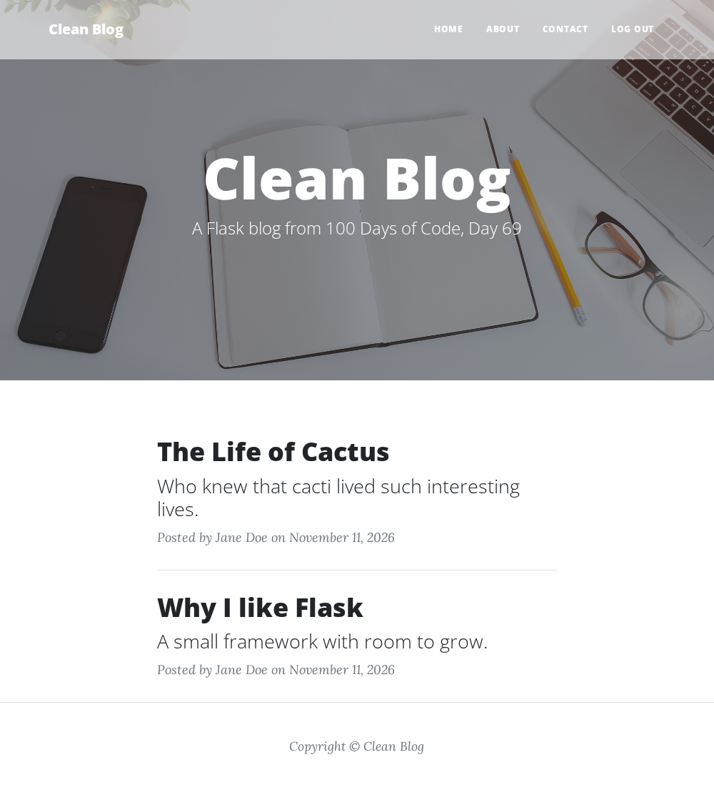
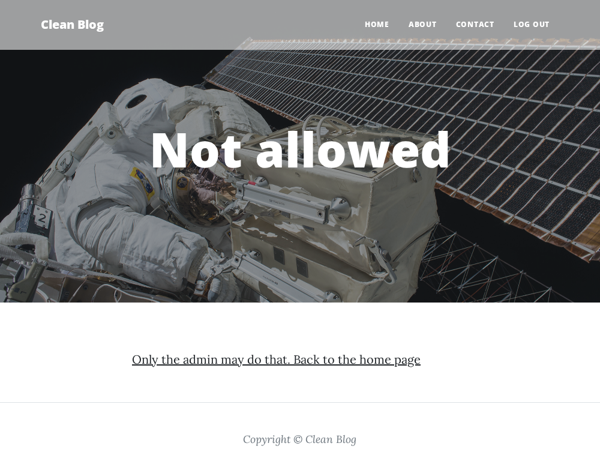
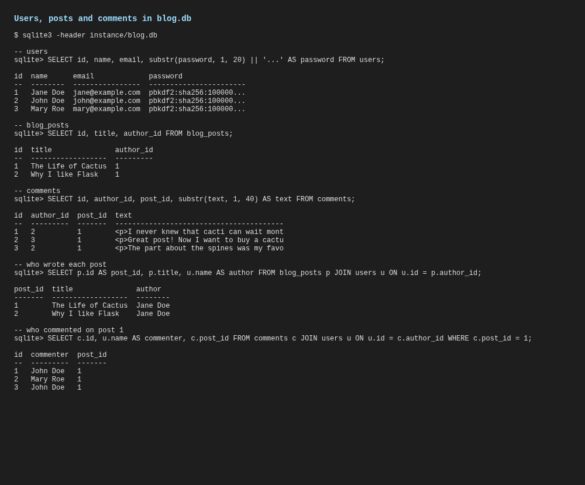
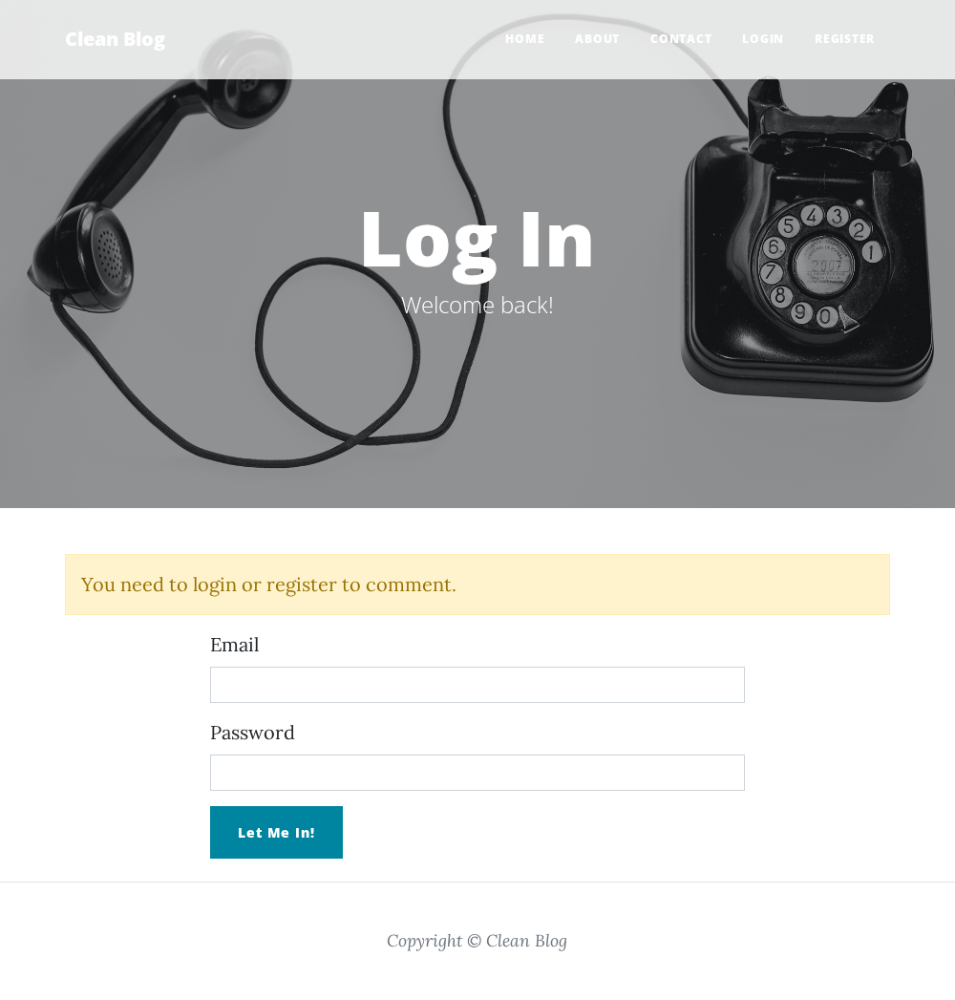
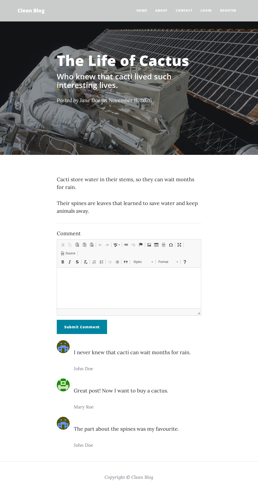
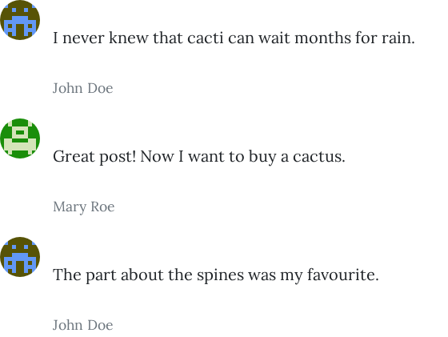

<!-- README from framework/templates/README-template.md -->

# 🚀 Blog Capstone Part 4 (Day 69)

A Flask blog with users, written for Day 69 of Udemy's "100 Days of Code: The Complete Python Pro Bootcamp". People register and log in, only the admin manages posts, logged-in users comment, and every commenter gets a Gravatar picture. It is written for course participants who want to compare solutions and for visitors looking for ideas.

## 📚 Table of Contents

- [Overview](#-overview)
- [Requirements](#-requirements)
- [Setup](#-setup)
- [Run](#-run)
- [Tests](#-tests)
- [License](#-license)
- [Links](#-links)
- [Appendix: Project documents](#-appendix-project-documents)

## 🧭 Overview

The lecture finishes the blog from Day 67: anyone can register and log in, only the admin (user id 1) can create, edit and delete posts, posts and comments are linked to their authors in a relational database, logged-in users can comment, and every commenter gets a Gravatar picture. The course's own starter and solution are not used: the blog is written from the lecture description, keeps the assignment's route and function names (`get_all_posts`, `show_post`, `add_new_post`, `edit_post`, `delete_post`, `register`, `login`, `logout`, `admin_only`) and is built in layers (Clean Architecture, see [ADR-0001][ADR-0001]).

The screenshots below come from this blog, run in a Docker container with example data (Jane Doe is the admin, John Doe and Mary Roe are members).

| Folder | Purpose |
| --- | --- |
| `src/blog/` | The blog: `domain`, `application`, `infrastructure` and `presentation` packages, and `constants.py` |
| `tests/` | pytest tests: `unit/` and `integration/` |
| `scripts/screenshots/` | Docker tooling that captures the screenshots below |
| `docs/` | Project documents, the screenshots (`docs/images/`) and the wiki (`docs/wiki/`) |

The [wiki][wiki] explains what each lecture step taught, in English, Danish and Bahasa Malaysia.

### Lecture steps

#### 1. Register new users

A `RegisterForm` (Flask-WTF) collects email, password and name. The `register` route creates a `User` in the `users` table. The password is hashed and salted with Werkzeug's `generate_password_hash()` before it is stored. The form is rendered with Bootstrap-Flask's `render_form()` macro, and `login_user()` logs the new user in and sends them home.


#### 2. Log in registered users

The `login` route finds the user by email and checks the password with `check_password_hash()`. Flask-Login's `login_user()` starts the session, and `flash()` tells the user when the email or password is wrong.




#### 3. Protect routes

The first registered user, id 1, is the admin. The home and post pages show "Create New Post", "Edit" and "Delete" only to the admin. Hiding a button does not protect a route, so a custom `@admin_only` decorator, built like `@login_required`, calls `abort(403)` for everyone else on `/new-post`, `/edit-post/<id>` and `/delete/<id>`.





#### 4. Create a relational database

A bidirectional one-to-many relationship links `User` (parent) to `BlogPost` (child) with a `ForeignKey` (`author_id`) and `relationship()` with `back_populates`. The schema changed, so the database is recreated, and the pages show the author's name from the `User` object.



#### 5. Allow any user to add comments

A `CommentForm` has one CKEditor field. A `Comment` table (`comments`) belongs to a `User` and to a `BlogPost`, both one-to-many. The `show_post` route accepts `GET` and `POST`; a user who is not logged in is flashed a message and sent to `/login`. The post page lists every comment. The HTML from CKEditor is sanitised with bleach before it is stored.





#### 6. Add Gravatar profile pictures

`flask-gravatar` no longer works with current Flask, so the avatar URL is built by hand: hash the trimmed, lowercased email and request `https://www.gravatar.com/avatar/<hash>`. People with a Gravatar account see their own picture; everyone else gets a default image.



## 📋 Requirements

- Python 3.13 or newer.
- `venv`, to keep the project's packages apart from the system Python.
- The runtime packages in `requirements.txt`: Flask, Flask-SQLAlchemy, Flask-Login, Flask-WTF, Flask-CKEditor, Bootstrap-Flask, bleach, email-validator and their dependencies. Flask-Login and the form packages are what the lecture names; bleach keeps the stored HTML safe.
- pytest, only to run the tests.
- Doxygen, only to generate the documentation of the source code (`Doxyfile`).
- Docker, only to recreate the screenshots, and opengrep for the maintainers' scan before a push.

## 🛠️ Setup

Create and use a local `.venv`, then upgrade `pip` and install the packages:

```bash
python -m venv .venv
source .venv/bin/activate        # Linux and macOS
.venv\Scripts\activate           # Windows (PowerShell or cmd)
python -m pip install --upgrade pip
python -m pip install -r requirements.txt
python -m pip install -e ".[dev]"
```

## ▶️ Run

```bash
python -m blog
```

The blog serves `http://127.0.0.1:5002`. Set `BLOG_SECRET_KEY` to keep sessions valid across restarts; without it a random key is used for each start. The database is `instance/blog.db`, created on the first start. **Register the admin first:** the first registered user has id 1 and is the admin who can create posts.

To recreate the screenshots (the browser runs in a Docker container, never on your desktop):

```bash
bash scripts/screenshots/capture_screenshot.sh --all
```

## 🧪 Tests

```bash
python -m pytest
```

The suite runs the unit and integration tests with coverage. Static checks used before each pull request:

```bash
python -m ruff check .
python -m mypy --strict src
```

## 📄 License

GNU Affero General Public License v3.0, see [LICENSE](LICENSE). The Clean Blog template files are MIT licensed, see [THIRD_PARTY_NOTICES.txt](THIRD_PARTY_NOTICES.txt).

## 🔗 Links

- [Repository][repository]
- [Documentation][documentation]
- [Issue tracker][issues]

## 📎 Appendix: Project documents

The documents a newcomer needs, in reading order.

| Document | What it tells you |
| --- | --- |
| [AGENTS.md][agents] | The rules AI agents follow in this repository |
| [Business Case][BC-001] | Why the project exists, its scope and success criteria |
| [Stakeholder Analysis][SA-001] | Who is involved; the stakeholder IDs used for owners and reviewers |
| [Project Plan][PP-001] | The gateways and their schedule |
| [Milestones][milestones] | One document per gateway: Go/No-Go criteria and tasks |
| [Architecture decision][ADR-0001] | Why the blog is built in layers |
| [Artifact registry][registry] | Where each artifact type lives, the next version, the PO language and domain |
| [Traceability matrix][TM-001] | How the artifacts link and when each was last reviewed |
| [Run summary][run-summary] | What the autonomous runs did and which decisions are open to challenge |
| [Framework README][framework-readme] | The framework this project uses |
| [Framework changelog][framework-changelog] | What changed in each framework release |

---

[repository]: https://git.tirsystem.com/Tirsvad-Udemy-100-days-of-code/069-blog-capstone-part-4
[wiki]: https://git.tirsystem.com/Tirsvad-Udemy-100-days-of-code/069-blog-capstone-part-4/wiki
[documentation]: https://git.tirsystem.com/Tirsvad-Udemy-100-days-of-code/069-blog-capstone-part-4/wiki
[issues]: https://git.tirsystem.com/Tirsvad-Udemy-100-days-of-code/069-blog-capstone-part-4/issues
[agents]: ./AGENTS.md
[BC-001]: ./docs/business-case.md
[SA-001]: ./docs/stakeholder-analysis.md
[PP-001]: ./docs/project-plan.md
[milestones]: ./docs/milestones/
[ADR-0001]: ./docs/adr/adr-0001-architecture.md
[registry]: ./docs/artifact-registry.md
[TM-001]: ./docs/sqa/traceability-matrix.md
[run-summary]: ./docs/run-summary.md
[framework-readme]: ./framework/README.md
[framework-changelog]: ./framework/CHANGELOG.md
