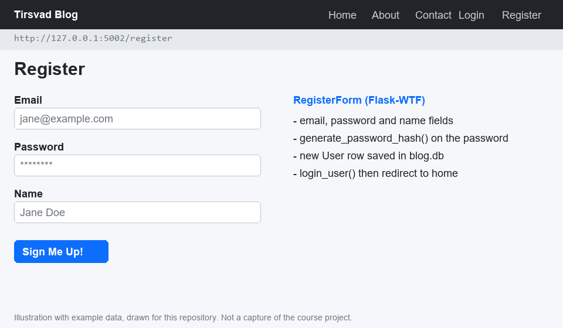
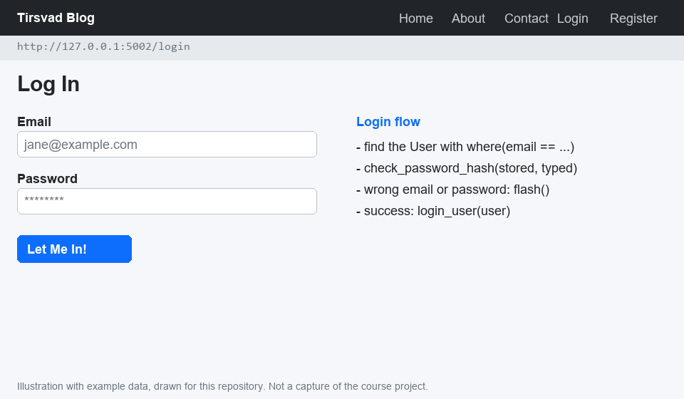
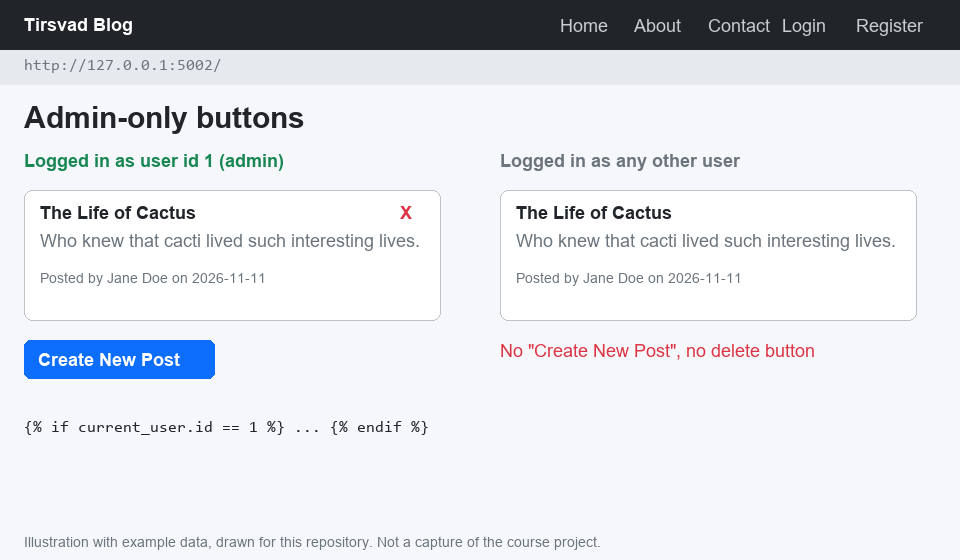
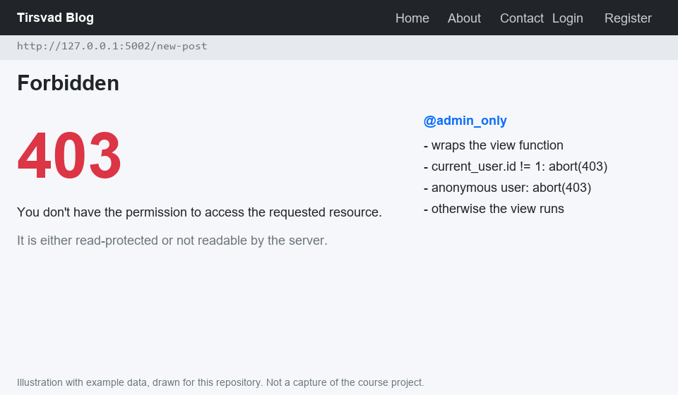
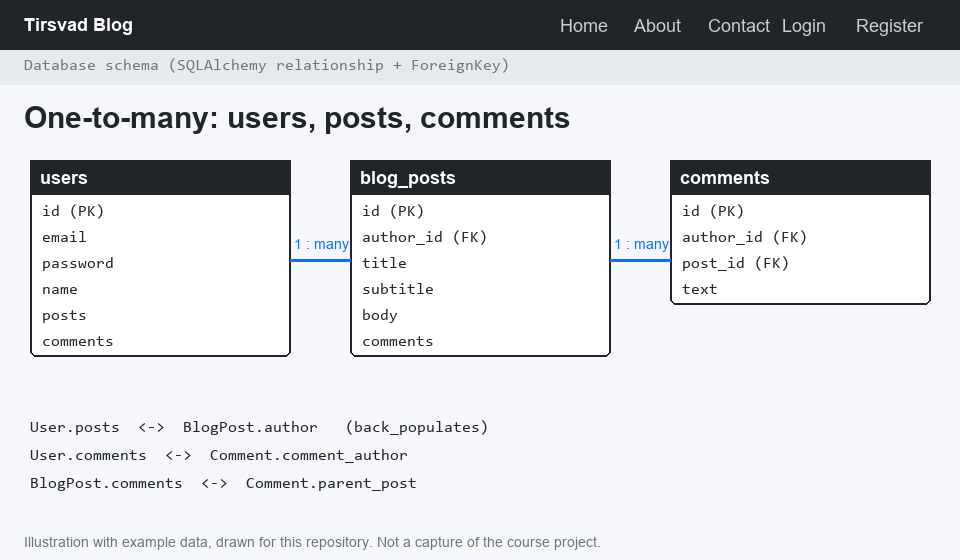
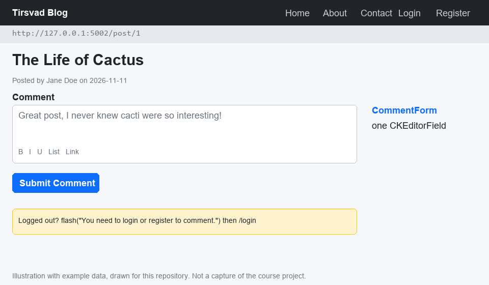
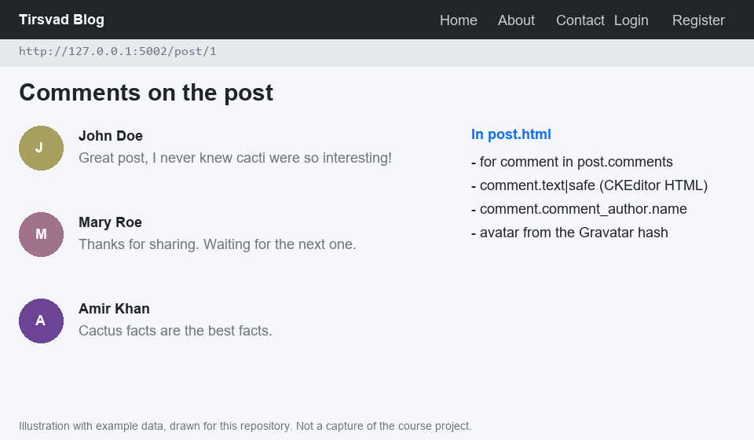
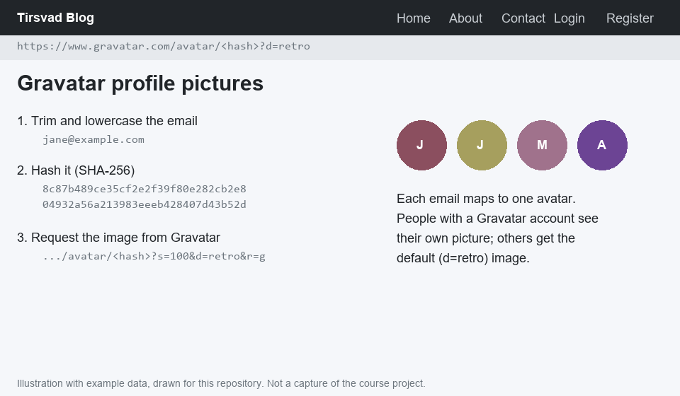

<!-- README from framework/templates/README-template.md -->

# 🚀 Blog Capstone Part 4 (Day 69)

A walkthrough of Day 69 of Udemy's "100 Days of Code: The Complete Python Pro Bootcamp": adding users to the blog capstone. It is written for course participants who want to compare solutions and for visitors looking for ideas. This repository holds documentation and project configuration only; it has no runtime dependencies.

## 📚 Table of Contents

- [Overview](#-overview)
- [Requirements](#-requirements)
- [Setup](#-setup)
- [Run](#-run)
- [Tests](#-tests)
- [License](#-license)
- [Links](#-links)
- [Appendix: Project documents](#-appendix-project-documents)

## 🧭 Overview

The lecture finishes the blog from Day 67: anyone can register and log in, only the admin (user id 1) can create, edit and delete posts, posts and comments are linked to their authors in a relational database, logged-in users can comment, and every commenter gets a Gravatar picture.

The images below are illustrations with example data, drawn for this repository from the lecture description. They are not captures of the course project, and the repository does not contain the course's code.

| Folder | Purpose |
| --- | --- |
| `src/` | Reserved for source code; empty, because this project does not program the lecture |
| `tests/` | Reserved for pytest tests; empty for the same reason |
| `docs/` | Project documents, the step images (`docs/images/`) and the wiki (`docs/wiki/`) |

The [wiki][wiki] explains what each lecture step taught, in English, Danish and Bahasa Malaysia.

### Lecture steps

#### 1. Register new users

A `RegisterForm` (Flask-WTF) collects email, password and name. The `/register` route creates a `User` in a new `users` table. The password is hashed and salted with Werkzeug's `generate_password_hash()` before it is stored. The form is rendered with Bootstrap-Flask's `render_form()` macro. After registering, one extra line, `login_user()`, logs the new user in and sends them home.



#### 2. Log in registered users

The `/login` route finds the user with a `where()` clause on the email and checks the password with `check_password_hash()`. Flask-Login's `login_user()` starts the session, and `flash()` tells the user when the email or password is wrong.



#### 3. Protect routes

The first registered user, id 1, is the admin. `index.html` and `post.html` show "Create New Post", "Edit Post" and the delete button only to the admin. Hiding a button does not protect a route, so a custom `@admin_only` decorator, built like `@login_required`, calls `abort(403)` for everyone else on `/new-post`, `/edit-post` and `/delete`.




#### 4. Create a relational database

A bidirectional one-to-many relationship links `User` (parent) to `BlogPost` (child) with a `ForeignKey` (`author_id`) and `relationship()` with `back_populates`. The schema changed, so the old `blog.db` is deleted and recreated, and `index.html` and `post.html` show `post.author.name`, because `author` is now a `User` object.



#### 5. Allow any user to add comments

A `CommentForm` has one CKEditor field. A `Comment` table (`comments`) belongs to a `User` and to a `BlogPost`, both one-to-many. The `/post/<int:post_id>` route accepts `GET` and `POST`; a user who is not logged in is flashed a message and sent to `/login`. `post.html` loops over `post.comments` and shows each comment's HTML text.




#### 6. Add Gravatar profile pictures

`flask-gravatar` no longer works with current Flask, so the avatar URL is built by hand: hash the lowercased email and request `https://www.gravatar.com/avatar/<hash>`. People with a Gravatar account see their own picture; everyone else gets a default image.



## 📋 Requirements

- Python 3.13 or newer.
- `venv`, to keep the project's packages apart from the system Python.
- pytest, only to run the (empty) test suite.
- Doxygen, only to generate documentation of source code that a later phase may add (`Doxyfile`).
- opengrep, a local security scan before each push (maintainers only).

## 🛠️ Setup

Create and use a local `.venv`, then upgrade `pip`:

```bash
python -m venv .venv
source .venv/bin/activate        # Linux and macOS
.venv\Scripts\activate           # Windows (PowerShell or cmd)
python -m pip install --upgrade pip
python -m pip install pytest
```

The project has no runtime dependencies. The lecture's own end project, which you download from the course, needs Flask, Flask-Login, Flask-SQLAlchemy, Flask-WTF, Flask-CKEditor and Bootstrap-Flask; install them in the same `.venv` from the `requirements.txt` that comes with the course download.

## ▶️ Run

This repository does not contain the application. Read the steps above, or open the [wiki][wiki]. The course's own end project starts with `python main.py` once its packages are installed (see Setup).

## 🧪 Tests

```bash
python -m pytest
```

There are no tests yet, so pytest reports that no tests were collected (exit code 5).

## 📄 License

GNU Affero General Public License v3.0, see [LICENSE](LICENSE).

## 🔗 Links

- [Repository][repository]
- [Documentation][documentation]
- [Issue tracker][issues]

## 📎 Appendix: Project documents

The documents a newcomer needs, in reading order.

| Document | What it tells you |
| --- | --- |
| [AGENTS.md][agents] | The rules AI agents follow in this repository |
| [Business Case][BC-001] | Why the project exists, its scope and success criteria |
| [Stakeholder Analysis][SA-001] | Who is involved; the stakeholder IDs used for owners and reviewers |
| [Project Plan][PP-001] | The gateways and their schedule |
| [Milestones][milestones] | One document per gateway: Go/No-Go criteria and tasks |
| [Artifact registry][registry] | Where each artifact type lives, the next version, the PO language and domain |
| [Traceability matrix][TM-001] | How the artifacts link and when each was last reviewed |
| [Framework README][framework-readme] | The framework this project uses |
| [Framework changelog][framework-changelog] | What changed in each framework release |

---

[repository]: https://git.tirsystem.com/Tirsvad-Udemy-100-days-of-code/069-blog-capstone-part-4
[wiki]: https://git.tirsystem.com/Tirsvad-Udemy-100-days-of-code/069-blog-capstone-part-4/wiki
[documentation]: https://git.tirsystem.com/Tirsvad-Udemy-100-days-of-code/069-blog-capstone-part-4/wiki
[issues]: https://git.tirsystem.com/Tirsvad-Udemy-100-days-of-code/069-blog-capstone-part-4/issues
[agents]: ./AGENTS.md
[BC-001]: ./docs/business-case.md
[SA-001]: ./docs/stakeholder-analysis.md
[PP-001]: ./docs/project-plan.md
[milestones]: ./docs/milestones/
[registry]: ./docs/artifact-registry.md
[TM-001]: ./docs/sqa/traceability-matrix.md
[framework-readme]: ./framework/README.md
[framework-changelog]: ./framework/CHANGELOG.md
