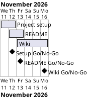

# Project Plan

## Metadata
| Key | Value |
| --- | --- |
| ID | PP-001 |
| CrossReference | [BC-001], [SA-001], [MIL-001], [MIL-002], [MIL-003] |
| Language | en |
| Domain | it |

## Version History
| Date | Status | Author | Reviewer | Change | Commit |
| --- | --- | --- | --- | --- | --- |
| 2026-11-11 | Proposed | Jens Tirsvad Nielsen | AI as stand-in for S01 | Initial version | pending |
| 2026-11-11 | Accepted | Jens Tirsvad Nielsen | AI as stand-in for S01 | Accepted on a Go review, RC-006; autonomous, not independent | pending |

---

## Purpose

Schedule the three phases that turn the Day 69 lecture into a README and a three-language wiki. The plan has no fixed deadline in the Business Case; it keeps a short, documentation-only schedule.

## Planning Assumptions

- The plan starts 2026-11-11 and ends by 2026-11-16, the duration constraint in [BC-001] (Constraints).
- Each phase is one branch and one pull request that closes its issues (source: the request of S01).
- S01 owns and reviews every phase; in autonomous mode the AI acts as stand-in reviewer and records it (source: AGENTS.md, Modes).

## Gateway Schedule

| Gateway | Document | Window | Decision date | Owner | Stories | Main deliverable | Milestone |
| --- | --- | --- | --- | --- | --- | --- | --- |
| Project setup | [MIL-001] | 2026-11-11 to 2026-11-12 | 2026-11-12 | S01 | none (documentation tasks) | Repository metadata and configuration | not yet synced |
| README | [MIL-002] | 2026-11-12 to 2026-11-13 | 2026-11-13 | S01 | none (documentation tasks) | README with step illustrations | not yet synced |
| Wiki | [MIL-003] | 2026-11-13 to 2026-11-16 | 2026-11-16 | S01 | none (documentation tasks) | Wiki in en, da, ms | not yet synced |



## Scope Coverage

| Business Case scope item | Gateway |
| --- | --- |
| Repository description and topics; `pyproject.toml`, `.gitignore`, `Doxyfile` | [MIL-001] |
| README, step images, `.venv` instructions | [MIL-002] |
| Wiki in three languages | [MIL-003] |
| opengrep scan before push | All gateways |

## Dependencies

```
MIL-001 → MIL-002 → MIL-003
```

A No-Go on a gateway moves every later gateway by the rework time and may move the end date of 2026-11-16; S01 decides any move of the end date.

## Plan Risks

| Risk | Impact | Mitigation |
| --- | --- | --- |
| Real screenshots are not available (BC-001 risk 1) | MIL-002 cannot reach Go with captures | Illustrations are labelled as such; S01 confirms the approach at plan acceptance |

## Open Issues

- Source of the step images: illustrations with example data drawn for this repository (S01 confirms at plan acceptance), or captures S01 supplies later.

---

[BC-001]: ./business-case.md
[SA-001]: ./stakeholder-analysis.md
[MIL-001]: ./milestones/mil-001-project-setup.md
[MIL-002]: ./milestones/mil-002-readme.md
[MIL-003]: ./milestones/mil-003-wiki.md
