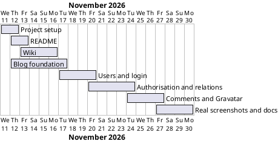

# Project Plan

## Metadata
| Key | Value |
| --- | --- |
| ID | PP-001 |
| CrossReference | [BC-001], [SA-001], [MIL-001], [MIL-002], [MIL-003], [MIL-004], [MIL-005], [MIL-006], [MIL-007], [MIL-008] |
| Language | en |
| Domain | it |

## Version History
| Date | Status | Author | Reviewer | Change | Commit |
| --- | --- | --- | --- | --- | --- |
| 2026-11-11 | Proposed | Jens Tirsvad Nielsen | AI as stand-in for S01 | Scope amended: the application code is in scope (S01 corrected the first prompt) | pending |
| 2026-11-11 | Accepted | Jens Tirsvad Nielsen | AI as stand-in for S01 | Accepted on a Go review, RC-010; autonomous, not independent | pending |

---

## Purpose

Schedule the phases that build the Day 69 blog, document it with real screenshots, and publish the README and the three-language wiki. The first three gateways (setup, README, wiki) are done and merged; the scope was then widened to include the application code (S01 corrected the first prompt), which adds gateways MIL-004 to MIL-008.

## Planning Assumptions

- The plan starts 2026-11-11 and ends by 2026-11-30, the duration constraint in [BC-001] (Constraints). The first end date, 2026-11-16, covered documentation only.
- Each phase is one branch and one pull request that closes its issues (source: the request of S01).
- S01 owns and reviews every phase; in autonomous mode the AI acts as stand-in reviewer and records it (source: AGENTS.md, Modes).
- The course starter and solution are not available, and the Day 67 repository holds no code, so the blog is written from the lecture description with the assignment's route and function names (source: the request of S01).
- Code is written with Clean Architecture and an MVVM-style presentation, recorded in an ADR in MIL-004; the screens follow the Start Bootstrap Clean Blog look of the lecture.

## Gateway Schedule

| Gateway | Document | Window | Decision date | Owner | Stories | Main deliverable | Milestone |
| --- | --- | --- | --- | --- | --- | --- | --- |
| Project setup | [MIL-001] | 2026-11-11 to 2026-11-12 | 2026-11-12 | S01 | none (configuration tasks) | Repository metadata and configuration | synced |
| README | [MIL-002] | 2026-11-12 to 2026-11-13 | 2026-11-13 | S01 | none (documentation tasks) | README with step illustrations | synced |
| Wiki | [MIL-003] | 2026-11-13 to 2026-11-16 | 2026-11-16 | S01 | none (documentation tasks) | Wiki in en, da, ms | synced |
| Blog foundation | [MIL-004] | 2026-11-12 to 2026-11-17 | 2026-11-17 | S01 | none (tasks follow the lecture steps) | Posts blog with create, edit, delete; architecture ADR | not yet synced |
| Users and login | [MIL-005] | 2026-11-17 to 2026-11-20 | 2026-11-20 | S01 | none | Register, login, logout, flash messages | not yet synced |
| Authorisation and relations | [MIL-006] | 2026-11-20 to 2026-11-24 | 2026-11-24 | S01 | none | admin_only, author relation, 403 | not yet synced |
| Comments and Gravatar | [MIL-007] | 2026-11-24 to 2026-11-27 | 2026-11-27 | S01 | none | Comments and avatars | not yet synced |
| Real screenshots and docs | [MIL-008] | 2026-11-27 to 2026-11-30 | 2026-11-30 | S01 | none | Screenshots in Docker; README and wiki updated | not yet synced |



## Scope Coverage

| Business Case scope item | Gateway |
| --- | --- |
| Repository description and topics; `pyproject.toml`, `.gitignore`, `Doxyfile` | [MIL-001] |
| README, step images, `.venv` instructions | [MIL-002], updated in [MIL-008] |
| Wiki in three languages | [MIL-003], updated in [MIL-008] |
| Blog application: posts, users, authorisation, relations, comments, Gravatar, with tests | [MIL-004], [MIL-005], [MIL-006], [MIL-007] |
| Real screenshots from a container | [MIL-008] |
| opengrep scan before push | All gateways |

## Dependencies

```
MIL-001 → MIL-002 → MIL-003
MIL-001 → MIL-004 → MIL-005 → MIL-006 → MIL-007 → MIL-008
```

A No-Go on a gateway moves every later gateway by the rework time and may move the end date of 2026-11-30; S01 decides any move of the end date.

## Plan Risks

| Risk | Impact | Mitigation |
| --- | --- | --- |
| The blog must be written without the course starter (BC-001 risk 1) | More effort than a lecture add-on | MIL-004 builds the Day 67 level first; the assignment's names are kept |
| Browser screenshots need a container, not the host desktop | MIL-008 is delayed | Reuse the Docker screenshot approach of the Day 63 project; stop after three failed rounds |
| New runtime dependencies (BC-001 risk 2) | S03 expectations | Only the lecture's packages |

## Open Issues

- The Clean Blog template files are reused from the Day 59 project (MIT licence, with its notice); S01 may replace them.

---

[BC-001]: ./business-case.md
[SA-001]: ./stakeholder-analysis.md
[MIL-001]: ./milestones/mil-001-project-setup.md
[MIL-002]: ./milestones/mil-002-readme.md
[MIL-003]: ./milestones/mil-003-wiki.md
[MIL-004]: ./milestones/mil-004-blog-foundation.md
[MIL-005]: ./milestones/mil-005-users-and-login.md
[MIL-006]: ./milestones/mil-006-authorisation-and-relations.md
[MIL-007]: ./milestones/mil-007-comments-and-gravatar.md
[MIL-008]: ./milestones/mil-008-screenshots-and-docs.md
[335e45c]: https://git.tirsystem.com/Tirsvad-Udemy-100-days-of-code/069-blog-capstone-part-4/commit/335e45c12d38b764705336eefde51af3c16930b2
